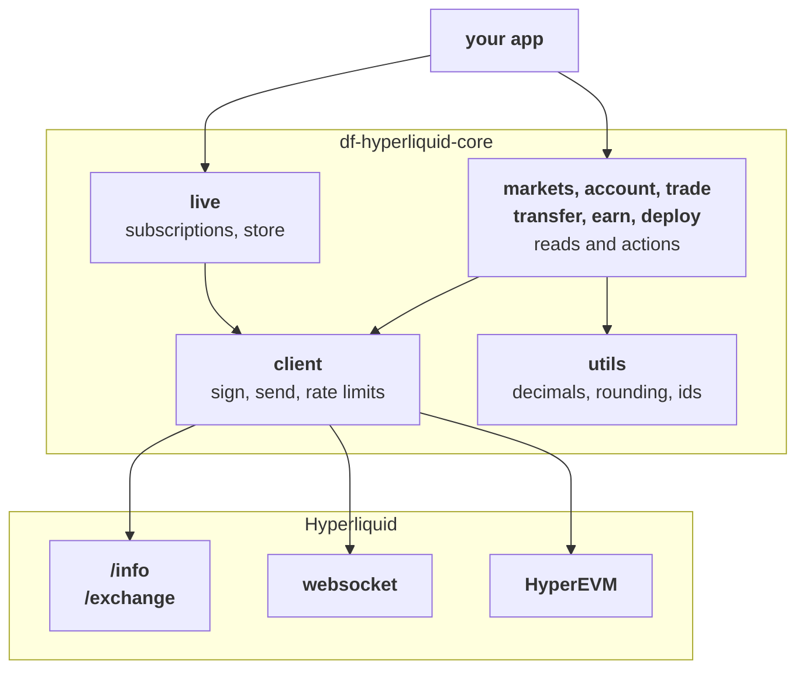

<p align="center">
  <a href="https://dfurrer.com">
    <picture>
      <source media="(prefers-color-scheme: dark)" srcset="https://dfu-cl-storybook.pages.dev/brand/markdfu-raised.svg">
      
    </picture>
  </a>
</p>

# df-hyperliquid-core

Rust SDK for [Hyperliquid](https://hyperliquid.xyz): markets, trading, transfers, earn and deploy in one crate, with exact decimals, signing and native or wasm transports.

## SDK

```text
df-hyperliquid-core
├── client          the Client, networks, rate limits
│   ├── http        /info and /exchange, the wire, the limit gate
│   ├── evm         HyperEVM JSON-RPC, transactions, ABI, precompiles, CoreWriter
│   ├── native      reqwest and tokio-tungstenite (feature native)
│   └── web         fetch and WebSocket (feature web)
├── markets         what is listed and what it trades at
│   ├── perps       meta, funding, margin tables
│   ├── spot        meta, token details
│   ├── dexes       HIP-3 dexes and their limits
│   └── outcomes    HIP-4 meta, books, prices, templates
├── account         what an address holds and who may sign for it
│   ├── holdings    perps, spot, outcomes, worth, what an order may use
│   ├── history     fills, orders, ledger, portfolio, fees
│   ├── keys        signers, API wallets, builder approvals
│   └── settings    margin mode, subaccounts, referrals, rate limits
├── trade           orders on every market
│   ├── orders      market, limit, trigger, TP/SL, scale, TWAP, close
│   ├── manage      cancel, modify, dead man's switch
│   ├── margin      leverage, isolated margin, margin tables
│   ├── builder     builder fees and their caps
│   └── outcomes    outcome fees, split and merge
├── transfer        sends, withdrawals, Arbitrum deposits, HyperCore to HyperEVM
├── earn            staking, vaults, lending
├── deploy          spot tokens, deploy auctions, HIP-3 dexes, HIP-4 outcome markets
├── live            websocket subscriptions, frames, connection state, a kept store
└── utils           decimals, rounding, asset ids, units, time, hex, nonces, signing
```



## Examples

| Example | What it does |
|---|---|
| `cargo run -p df-hyperliquid-core --example market_order` | Reads BTC's meta, book and context from mainnet, prints the unsigned market order for a $20 long |

## Tests

```text
packages/core
├── src/**/tests       unit: decimals, rounding, encoding, signing, refusals, state machines
├── tests
│   ├── conformance    signatures match @nktkas/hyperliquid, the Python SDK and viem
│   ├── mocked         whole journeys through Client against a fake venue that checks every signature
│   └── live           mainnet, read only: every read, websocket channel and HyperEVM read
├── fixtures           recorded venue answers
└── vectors            what other implementations produce
```

| Command | What it runs |
|---|---|
| `just check` | format, lint, unit, conformance, mocked, the browser transport in Node, docs |
| `just live` | the live suite against mainnet, each answer held against its recording |
| `just cover` | line coverage of everything but the live suite |

## Reference implementations

- [metalliq.xyz](https://metalliq.xyz)
- [tui.hip4.dev](https://tui.hip4.dev)

<br>

<p align="center">
  <sub><sub><a href="https://dfurrer.com">DFU</a></sub></sub>
  &emsp;&emsp;&emsp;
  <sub><a href="https://dfurrer.com">dfurrer.com</a></sub>
  &emsp;&emsp;&emsp;
  <sub><sub><a href="https://dfurrer.com">df.hl</a></sub></sub>
</p>
