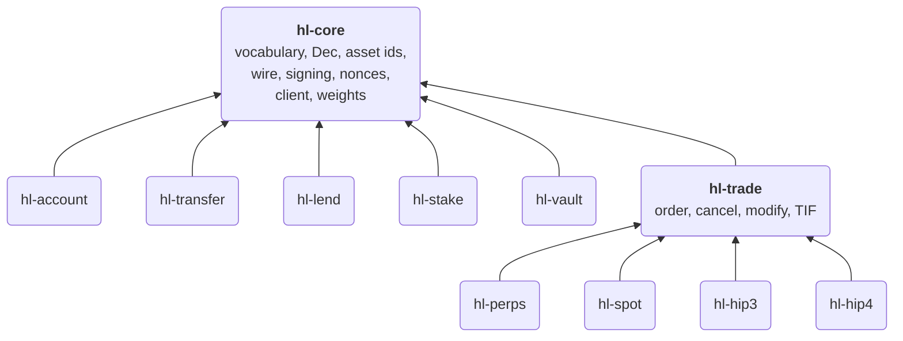

# hl-rust

The Hyperliquid family. `hl-core` is the backbone; every other crate is one product area on top of it.

| Crate | Owns |
|---|---|
| `hl-core` | vocabulary, exact decimals, asset ids (perps, spot, HIP-3, HIP-4) and their builder caps, builder fees in tenths of a basis point, exact integer units (USDC 1e6, HYPE 1e8), floats kept as written (`Figure`), msgpack wire, L1 and user-signed signing, nonces, info and exchange client over a transport trait |
| `hl-account` | clearinghouse and spot state, account modes and changing them (`userSetAbstraction`, `agentSetAbstraction`; unified back to standard is refused), agent wallets (`approveAgent`, `extraAgents`, `userRole`; no revoke, never re-approve an old agent), builder fee approval (`approveBuilderFee`, `maxBuilderFee`), subaccounts (`createSubAccount`, `subAccountTransfer`, `subAccountSpotTransfer`, `subAccounts`), referrals (`setReferrer`, `referral`) |
| `hl-transfer` | usdSend, spotSend, sendAsset (also between the account's own balances), usdClassTransfer, withdraw3, amount checks, preTransferCheck, system-address guard, ledger history, Arbitrum bridge deposit calldata |
| `hl-trade` | `order` (limit and trigger, grouping, builder and its cap), `cancel`, `cancelByCloid`, `modify`, `batchModify`, `twapOrder`, `twapCancel`, `updateLeverage`, `updateIsolatedMargin`; tick and lot rounding (`Grid`: a price never rounds against the trader, a size toward zero); market orders are `FrontendMarket`, never `Gtc` |
| `hl-perps` | main dex `meta` and `metaAndAssetCtxs`, each perp's asset id and grid, leverage and isolated margin checked against what the asset allows |
| `hl-spot` | `spotMeta` and `spotMetaAndAssetCtxs`, token lookup (index, name, `NAME:0x<tokenId>`, size and wei decimals), pair lookup and its grid |
| `hl-hip3` | `perpDexs`, per-dex `meta` and `metaAndAssetCtxs`, dex asset ids |
| `hl-hip4` | outcome coins (`#`/`+` spellings, asset ids), the outcome price grid and market orders at the edge of the range, `outcomeMeta`, `userOutcome` split and merge, `outcomeDeploy` (register, settle, sub-deployers; settling cannot be undone), `activateOutcomeDeployer` |
| `hl-lend` | `borrowLend` (supply, withdraw, borrow, repay; `null` for all), `allBorrowLendReserveStates`, `borrowLendUserState` |
| `hl-stake` | `cDeposit`, `cWithdraw`, `tokenDelegate`, validators, delegator summary, delegations, rewards and history; the one-day delegation lock and seven-day unstaking queue |
| `hl-vault` | `vaultTransfer`, `vaultDetails`, `userVaultEquities`, `leadingVaults`; lockups (HLP four days, others one) |

## Rules

- **Layering:** a crate depends on `hl-core`. The four market crates may also depend on `hl-trade`. Nothing else crosses.
- **Standalone:** no `hl-*` crate depends on an app. hip4-tui, atlas and coreserve are consumers, never dependencies.
- **Targets:** every crate builds native and `wasm32-unknown-unknown`. No tokio, no OS keychain in the family; transports plug in from outside.
- **Money:** `Dec`, never floats (`clippy::float_arithmetic` denied in every crate).
- **Signing:** golden vectors before any new action (`vectors/`, each file naming the implementation that made it). A crate never holds the user's wallet key.
- **Network:** mainnet or testnet, and every signature names one: an action signed for one network is never valid on the other, so nothing assumes it. `/exchange` is never retried.
