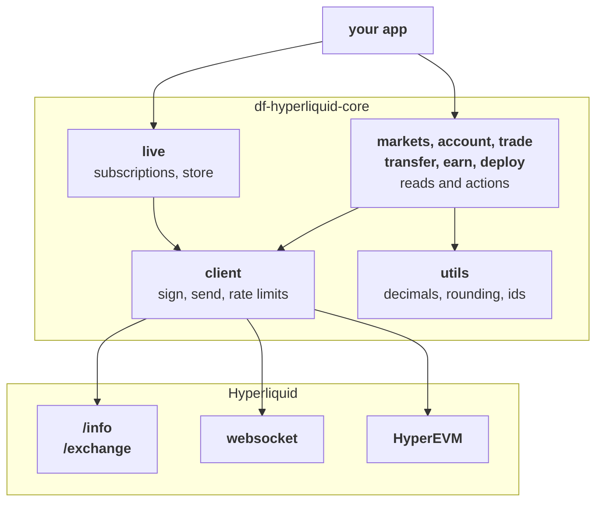

<p align="center">
  <a href="https://dfurrer.com">
    <picture>
      <source media="(prefers-color-scheme: dark)" srcset="https://dfu-cl-storybook.pages.dev/brand/markdfu-raised.svg">
      
    </picture>
  </a>
</p>

# df-hyperliquid-core

[](https://crates.io/crates/df-hyperliquid-core)
[](https://docs.rs/df-hyperliquid-core)
[](#license)
[](https://github.com/dennisfurrer/df-hyperliquid-core/actions/workflows/check.yml)

Rust SDK for [Hyperliquid](https://hyperliquid.xyz): markets, trading, transfers, earn, validators and deploys (spot, HIP-3 and HIP-4) in one crate, with full parity with the Hyperliquid API docs, exact decimals, the fastest order signing and websocket parsing of the SDKs benchmarked, and native or wasm transports.

Project page: [dfurrer.com/products/df-hyperliquid-core](https://dfurrer.com/products/df-hyperliquid-core). For how Hyperliquid itself works (HyperCore, the HyperEVM, perps, outcome markets, signing, rate limits), see [HyperBooks](https://hyperbooks.xyz), the Hyperliquid documentation by the same author, and its [list of Hyperliquid SDKs and developer tools](https://hyperbooks.xyz/start/developer-tools/).

## SDK

```text
df-hyperliquid-core
├── client          the Client, networks, rate limits
│   ├── http        /info and /exchange, the wire, the limit gate
│   ├── evm         HyperEVM JSON-RPC, transactions, ABI, precompiles, CoreWriter
│   ├── native      reqwest and tokio-tungstenite (feature native)
│   └── web         fetch and WebSocket (feature web)
├── markets         what is listed and what it trades at
│   ├── perps       meta, funding, margin tables
│   ├── spot        meta, token details
│   ├── dexes       HIP-3 dexes and their limits
│   └── outcomes    HIP-4 meta, books, prices, templates
├── account         what an address holds and who may sign for it
│   ├── holdings    perps, spot, outcomes, worth, what an order may use
│   ├── history     fills, orders, ledger, portfolio, fees
│   ├── keys        signers, API wallets, builder approvals
│   └── settings    margin mode, subaccounts, referrals, rate limits
├── trade           orders on every market
│   ├── orders      market, limit, trigger, TP/SL, scale, TWAP, close
│   ├── manage      cancel, modify, dead man's switch
│   ├── margin      leverage, isolated margin, margin tables
│   ├── builder     builder fees and their caps
│   └── outcomes    outcome fees, split and merge
├── transfer        sends, withdrawals, Arbitrum deposits, HyperCore to HyperEVM
├── earn            staking, vaults, lending, validators
├── deploy          spot tokens, deploy auctions, HIP-3 dexes, HIP-4 outcome markets
├── live            websocket subscriptions, frames, connection state, a kept store
└── utils           decimals, rounding, asset ids, units, time, hex, nonces, signing
```



## Cargo features

| Feature | Default | What it adds |
|---|---|---|
| `sign` | yes | Signing and recovery through k256, pure Rust. Without it, actions build and hash but nothing signs. |
| `native` | yes | HTTP and websocket for native programs: reqwest and tokio-tungstenite. |
| `web` | no | HTTP and websocket for the browser and Workers: fetch and WebSocket. |
| `secp256k1` | no | On native targets, signing and recovery through libsecp256k1, the C library Bitcoin Core uses: about twice as fast to sign and five times as fast to recover, with the same bytes. Needs a C compiler for the target, which matters for musl and cross builds. No effect on wasm. |
| `offline` | no | The transports refuse anything signed, for a dependent's test build. |

## Examples

| Example | What it does |
|---|---|
| `cargo run -p df-hyperliquid-core --example market_order` | Reads BTC's meta, book and context from mainnet, prints the unsigned market order for a $20 long |
| `HL_PRIVATE_KEY=0x... cargo run -p df-hyperliquid-core --example signed_order` | Signs a post-only BTC limit buy 30% under the mid and the cancel for it, and prints both signed bodies; with `HL_SEND=1` it places the order on mainnet and cancels it |
| `cargo run -p df-hyperliquid-core --example subscribe` | Opens the mainnet websocket, subscribes to BTC's book and trades, prints ten updates and exits |
| `HL_PRIVATE_KEY=0x... cargo run -p df-hyperliquid-core --example outcome_trade` | Lists the HIP-4 outcome markets with their titles, picks one with a bid, signs a post-only buy of Yes at half the bid and the cancel for it; with `HL_SEND=1` it places the order and cancels it |
| `cargo build -p df-hyperliquid-core --example web_book --no-default-features --features sign,web --target wasm32-unknown-unknown` | Builds a wasm module that exports `btcMid()`, which reads BTC's book through the global `fetch`; bind it with `wasm-bindgen --target nodejs` or `--target web` |

## Feature parity

Full parity with the [Hyperliquid API docs](https://hyperliquid.gitbook.io/hyperliquid-docs/for-developers/api): every info request, exchange action, websocket channel and HyperEVM method the docs list is in the crate.

How the signed actions are checked:

- Against @nktkas/hyperliquid and the official Python SDK, byte for byte, in `tests/conformance`.
- On testnet, with `just testnet`: every L1 action is signed by a new key that has no account and posted to `/exchange`. The node must read the action and recover that key's address, which shows it parsed every field and hashed the same bytes. Nothing can execute from an empty account. All 159 accepted actions pass (2026-11-24).
- The units of the numbers that cannot be undone (genesis amounts, gas, validator commission and stake, open interest caps) are confirmed against real mainnet and testnet deploys and the state they produced, and each one is named in its doc comment.

| API area | Status | Module |
|---|---|---|
| Info: perps (meta, contexts, all dexes' metas, funding, predicted funding, open interest caps, active asset data, dex limits and status, categories, annotations, deploy auction) | Supported | `markets::perps`, `markets::dexes`, `account::holdings`, `deploy` |
| Info: spot (meta, contexts, balances, token details, deploy state, pair deploy auction) | Supported | `markets::spot`, `account::holdings`, `deploy` |
| Info: HIP-4 outcomes (meta, templates, settled outcomes, deployer limits) | Supported | `markets::outcomes` |
| Info: market data (mids, L2 book, candles, recent trades) | Supported | `markets` |
| Info: user state (clearinghouse, open orders, order status, rate limit, role, subaccounts, fees, referral, abstraction, agents, builder fee approval, approved builders) | Supported | `account` |
| Info: history (fills, fills by time, historical orders, TWAP history and slice fills, funding, ledger, portfolio) | Supported | `account::history`, `markets::perps` |
| Info: vaults, staking and lending (vault details and equities, delegations, staking summary, history and rewards, validators, borrow and lend states) | Supported | `earn` |
| Exchange: orders (limit, market, trigger, TP/SL, trailing stop, scale, close) | Supported | `trade::orders` |
| Exchange: cancel, cancel by cloid, schedule cancel, noop | Supported | `trade::manage` |
| Exchange: modify, batch modify | Supported | `trade::manage` |
| Exchange: TWAP order and cancel | Supported | `trade::orders` |
| Exchange: leverage and isolated margin | Supported | `trade::margin` |
| Exchange: transfers (`usdSend`, `spotSend`, `sendAsset`, `agentSendAsset`, `usdClassTransfer`, subaccount transfers, `sendToEvmWithData`, HyperCore to HyperEVM) | Supported | `transfer`, `account::settings` |
| Exchange: withdrawals (`withdraw3`) and Arbitrum deposits | Supported | `transfer` |
| Exchange: vaults (`vaultTransfer`, `hip3LiquidatorTransfer`) | Supported | `earn::vaults` |
| Exchange: staking (`cDeposit`, `cDeposit2`, `cWithdraw`, `tokenDelegate`, `claimRewards`) | Supported | `earn::staking`, `account::settings` |
| Exchange: lending (`borrowLend`) | Supported | `earn::lending` |
| Exchange: API wallets (`approveAgent`) | Supported | `account::keys` |
| Exchange: builder fees (`approveBuilderFee`) | Supported | `account::keys`, `trade::builder` |
| Exchange: account settings (`userSetAbstraction`, `agentSetAbstraction`, `createSubAccount`, `setReferrer`, `reserveRequestWeight`) | Supported | `account::settings` |
| Exchange: HIP-4 outcome positions (`userOutcome`: split, merge, `mergeQuestion`, `negateOutcome`) | Supported | `trade::outcomes` |
| Exchange: multi-sig (`multiSig`, `convertToMultiSigUser`) | Supported | `utils::sign::multi_sig`, `account::keys` |
| Exchange: validator actions (`validatorL1Stream`, `authorizeAqav2Role`, `CValidatorAction`, `CSignerAction`) | Supported | `deploy::aligned`, `earn::validator` |
| Deploy: spot tokens (`spotDeploy`, every sub-action the node accepts, and `finalizeEvmContract`) | Supported | `deploy::spot` |
| Deploy: HIP-3 perp dexes (`perpDeploy`, every sub-action) | Supported | `deploy::perp` |
| Deploy: HIP-4 outcome markets (`outcomeDeploy`, `activateOutcomeDeployer`) | Supported | `deploy::outcomes` |
| Websocket subscriptions (every channel, including `l2`, `pac` and `sac`) | Supported | `live`, `client::native::Feed`, `client::web::Feed` |
| Websocket post (info reads and signed actions) | Supported | `live::Post`, `Feed::post` |
| HyperEVM JSON-RPC (every method the docs list) | Supported | `client::evm::rpc` |
| HyperCore read precompiles (`0x0800` to `0x0814`) | Supported | `client::evm::precompiles` |
| CoreWriter (actions 1 to 17) | Supported | `client::evm::corewriter` |

Not included:

- `userDexAbstraction` and `agentEnableDexAbstraction`: deprecated, and mainnet no longer accepts them. `userSetAbstraction` and `agentSetAbstraction` replace them.
- The HIP-3 `star` operations: the docs mark them testnet only, and the crate does not target testnet.
- `enableAlignedQuoteToken` and `disableAlignedQuoteToken`: the docs list them, but mainnet and testnet refuse both with `422 Failed to deserialize` for every shape, the answer for an action that does not exist. The crate keeps them, deprecated, until the node accepts them; `just testnet` fails when it does.

## Benchmarks

df-hyperliquid-core signs orders and parses websocket frames faster than the other SDKs measured. With its defaults it signs 1.3 times as fast as hypersdk, and 2.6 times as fast with the `secp256k1` feature. It parses recorded mainnet frames 2.4 times as fast as hypersdk (2.7 times on books), with a lower p99 and fewer allocations per frame. Round trips to the venue are the same for all three SDKs, because the network takes almost all of the time.

| Measurement | df-hyperliquid-core | hypersdk 0.3.1 | hyperliquid-python-sdk 0.24.0 |
|---|---|---|---|
| Hash and sign one BTC order, median | 25.6 us (13.1 us with `secp256k1`) | 33.8 us | 2017.0 us (122.2 us with coincurve) |
| Websocket parse, recorded frames | 1,145,475 frames/s | 477,986 frames/s | 224,450 frames/s (prices left as strings) |
| Websocket parse, `l2Book` frames | 823,194 frames/s | 301,107 frames/s | 147,679 frames/s |
| Websocket parse, p99 of one frame | 2.9 us | 4.7 us | 10.5 us |
| Allocations per frame | 4.7 | 7.7 | not measured |
| Info round trip (`l2Book`), median | 237.9 ms | 238.8 ms | 238.7 ms |
| Exchange round trip (refused order), median | 266.9 ms | 262.7 ms | 257.1 ms |

Measured on 2026-11-27 on one Apple M5 Max, from Zurich, each offline figure the median of 5 runs. The round trips differ by less than the spread between requests and show parity, not a ranking. The method, p99 figures, raw samples and the command to rerun them are in [bench/README.md](bench/README.md).

## Tests

```text
packages/core
├── src/**/tests       unit: decimals, rounding, encoding, signing, refusals, state machines
├── tests
│   ├── conformance    signatures match @nktkas/hyperliquid, the Python SDK and viem
│   ├── mocked         whole journeys through Client against a fake venue that checks every signature
│   └── live           mainnet, read only: every read, websocket channel and HyperEVM read
├── fixtures           recorded venue answers
├── vectors            what other implementations produce
└── fuzz               the frame readers, the decimal readers and the two signing backends
```

The direct frame reader is also checked against 5,500 recorded mainnet frames in `bench/data` (books, fast books, bucketed books, best bid and offer, trades) by `just test`.

| Command | What it runs |
|---|---|
| `just check` | format, lint, unit, conformance, mocked, the browser transport in Node, docs; with and without `secp256k1`, and for wasm |
| `just live` | the live suite against mainnet, each answer held against its recording |
| `just cover` | line coverage of everything but the live suite |
| `just fuzz <target> <secs>` | one fuzz target (`decode`, `dec` or `backends`), on nightly with cargo-fuzz |

## Used in production

| Project | What it is |
|---|---|
| [tui.hip4.dev](https://tui.hip4.dev) | The Hyperliquid terminal: every account, market and protocol call, in one Rust binary |
| [Atlas](https://at.market) | Macro trading and global intelligence platform |
| [metalliq.xyz](https://metalliq.xyz) | Papertrade and cardboard side by side, hedged with a HIP-3 perp on Hyperliquid |

### Crates built on df-hyperliquid-core

| Crate | What it is |
|---|---|
| [df-papertrade-core](https://crates.io/crates/df-papertrade-core) | Rust SDK for papertrade.xyz |
| [df-elysium-core](https://crates.io/crates/df-elysium-core) | Rust SDK for Elysium and its HyperEVM bridge |
| [hip4-vanity](https://crates.io/crates/hip4-vanity) | Searches for an address that scores well against a set of criteria |

All dependents are listed on [crates.io](https://crates.io/crates/df-hyperliquid-core/reverse_dependencies).

### Built with df-hyperliquid-core?

Add the badge to your README and open an issue to be listed here:

[](https://dfurrer.com/products/df-hyperliquid-core)

```markdown
[](https://dfurrer.com/products/df-hyperliquid-core)
```

## Stability

- Versions follow [semantic versioning](https://semver.org) from 0.1.0. Within 0.1.x, patch releases never break the public API. A breaking change waits for 0.2.0 and is listed in [CHANGELOG.md](CHANGELOG.md).
- Enums, and the structs the crate returns, are `#[non_exhaustive]`: a new variant or field is not a breaking change, so a `match` needs a `_` arm. Structs you build yourself (order intents, plan contexts, transport, deploy payloads) are not, and a new field in one waits for the next minor version.
- Moving from 0.1 or a 0.0.x beta: [MIGRATION.md](MIGRATION.md) lists what to change, including every moved, renamed and removed item since 0.0.8.
- When Hyperliquid changes the shape of a request or answer, the fix ships as a patch release if the crate's public API can stay the same.
- Minimum supported Rust version (MSRV): 1.94, edition 2024. CI builds with the toolchain pinned in `rust-toolchain.toml`. The MSRV is raised only in a minor release, and the change is noted in the changelog.
- Questions and bugs: [GitHub issues](https://github.com/dennisfurrer/df-hyperliquid-core/issues).

## License

Versions 0.0.11-beta and later are licensed under either of

- Apache License, Version 2.0 ([LICENSE-APACHE](LICENSE-APACHE))
- MIT license ([LICENSE-MIT](LICENSE-MIT))

at your option. Versions up to 0.0.10-beta were published under BUSL-1.1.

Unless you explicitly state otherwise, any contribution intentionally submitted for inclusion in this crate, as defined in the Apache-2.0 license, shall be dual licensed as above, without any additional terms or conditions.

<br>

<p align="center">
  <sub><sub><a href="https://dfurrer.com">DFU</a></sub></sub>
  &emsp;&emsp;&emsp;
  <sub><a href="https://dfurrer.com">dfurrer.com</a></sub>
  &emsp;&emsp;&emsp;
  <sub><sub><a href="https://dfurrer.com">df.hl</a></sub></sub>
</p>
