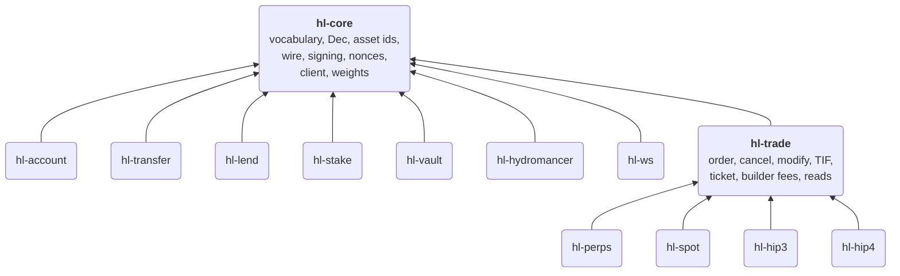

# hl-rust

The Hyperliquid family. `hl-core` is the backbone; every other crate is one product area on top of it.

| Crate | Owns |
|---|---|
| `hl-core` | vocabulary, exact decimals, asset ids (perps, spot, HIP-3, HIP-4) and their builder caps, builder fees in tenths of a basis point, exact integer units (USDC 1e6, HYPE 1e8), floats kept as written (`Figure`), msgpack wire, L1 and user-signed signing, nonces, info and exchange client over a transport trait |
| `hl-account` | clearinghouse and spot state, account modes and changing them (`userSetAbstraction`, `agentSetAbstraction`; unified back to standard is refused), agent wallets (`approveAgent`, `extraAgents`, `userRole`; no revoke, never re-approve an old agent), builder fee approval (`approveBuilderFee`, `maxBuilderFee`), subaccounts (`createSubAccount`, `subAccountTransfer`, `subAccountSpotTransfer`, `subAccounts`), referrals (`setReferrer`, `referral`) |
| `hl-transfer` | usdSend, spotSend, sendAsset (also between the account's own balances), `agentSendAsset` (the same, signed by an agent), usdClassTransfer, withdraw3, amount checks, preTransferCheck, system-address guard, Core to HyperEVM (`spotSend` from a separate account, `sendAsset` from a pooled one; the way back is hl-evm's), plans (the key each needs, the balance a read back checks), ledger history and the row a send made, Arbitrum bridge deposit calldata on both networks |
| `hl-trade` | `order` (limit and trigger, grouping, builder and its cap), `cancel`, `cancelByCloid`, `modify` and `batchModify` (always place for a trigger), `scheduleCancel` (the dead man's switch), `noop`, `twapOrder`, `twapCancel`, `updateLeverage`, `updateIsolatedMargin`; tick and lot rounding (`Grid`: a price never rounds against the trader, a size toward zero); the ticket (intent to the exact action or a typed refusal: minimum order value, market orders `FrontendMarket` at a slippage bound and never `Gtc`, TP/SL grouped and modified, scales, closing a position); builder fees as a setting (a share of each kind's cap in integer math, no builder named) and the `approveBuilderFee` check; what `/exchange` answers per order, cancel and modify; `openOrders`, `frontendOpenOrders`, `orderStatus`, `historicalOrders`, `userFills`, `userFillsByTime`, `userTwapSliceFills`, `userFees`, `l2Book`, `candleSnapshot`, `recentTrades`, `allMids` |
| `hl-perps` | main dex `meta` and `metaAndAssetCtxs`, each perp's asset id, grid and rules, margin tables, leverage checked against what the asset allows and the tier a position reaches, isolated margin; positions and margin summaries (`clearinghouseState`), `activeAssetData`, `fundingHistory`, `userFunding` (windows and pages), `predictedFundings`, `perpsAtOpenInterestCap`; the account reads take a HIP-3 dex |
| `hl-spot` | `spotMeta` and `spotMetaAndAssetCtxs`, token lookup (index, name, token id, `NAME:0x<tokenId>`, size and wei decimals), pair lookup (index, book name, asset id, tokens) and its grid, a token's USDC price, `tokenDetails`, `spotDeployState`, `spotPairDeployAuctionStatus`; nothing keyed to one network's indexes |
| `hl-hip3` | `perpDexs` and `allPerpMetas` lined up, per-dex `meta` and `metaAndAssetCtxs`, dex asset ids and coins, `perpDexLimits`, `perpDexStatus`, funding multipliers, rates and clamps, margin tables and leverage, `perpDeployAuctionStatus`; no `perpDeploy` until a vector pins it |
| `hl-hip4` | outcome coins (`#`/`+` spellings, asset ids), the outcome price grid and market orders at the edge of the range, `outcomeMeta`, `userOutcome` split and merge, `outcomeDeploy` (register, settle, sub-deployers; settling cannot be undone), `activateOutcomeDeployer` |
| `hl-lend` | `borrowLend` (supply, withdraw, borrow, repay; `null` for all), `allBorrowLendReserveStates`, `borrowLendReserveState`, `borrowLendUserState`; utilization, the borrow and supply rates, what a holding backs and what can still be borrowed, health; plans |
| `hl-stake` | `cDeposit`, `cWithdraw`, `tokenDelegate`, validators, delegator summary, delegations, rewards and history, a whole stake with its pending withdrawals; the delegation lock and unstaking queue (a day and seven on mainnet, two and five minutes on testnet, five at once); plans |
| `hl-vault` | `vaultTransfer`, `vaultDetails` (strategies, follower state, what may leave now), `userVaultEquities`, `leadingVaults`; HLP on each network; lockups (HLP four days; others a day on mainnet, twenty seconds on testnet); plans |
| `hl-hydromancer` | Hydromancer, a third-party data provider, mainnet only (`Hydromancer::mainnet`, the caller's key as a bearer header, cut from any error): the L4 book (`l4Book` snapshot decoder, the `l4BookUpdates` socket frames, an `Assembler` that resyncs on a height gap, `Book` with matching and owners, L4 to L2 levels), the outcome builder dashboard, `perpPriceHistoryByTime`, the `builderFills` socket, and Hyperliquid's daily `builder_fills` files |
| `hl-ws` | the public websocket, sans-IO: every subscription the docs list (and `assetCtxs`, `spotAssetCtxs`, `userHistoricalOrders`), the subscribe, unsubscribe, ping and post frames, each channel decoded into exact `Dec` (an unknown one kept as written), and the connection's state machine: resubscribe on open, a ping after 30 s of quiet, a reconnect after 60 s of silence, delays doubling from 250 ms to 20 s with jitter and no last attempt, the venue's per-IP limits refused before anything is sent |

## Rules

- **Layering:** a crate depends on `hl-core`. The four market crates may also depend on `hl-trade`. Nothing else crosses.
- **Standalone:** no `hl-*` crate depends on an app. hip4-tui, atlas and coreserve are consumers, never dependencies.
- **Targets:** every crate builds native and `wasm32-unknown-unknown`. No tokio, no OS keychain in the family; transports plug in from outside.
- **Money:** `Dec`, never floats (`clippy::float_arithmetic` denied in every crate).
- **Signing:** golden vectors before any new action (`vectors/`, each file naming the implementation that made it). A crate never holds the user's wallet key.
- **Features:** the curve is `hl-core`'s `sign` feature. Every crate takes `hl-core` without it, so an app that only reads never compiles `k256`; one that signs asks for it.
- **Rate limit:** every request goes through `hl_core::Api`, one network's endpoints behind one gate: reads hold back near the IP's 1,200 a minute, and a 429 closes the gate for everything.
- **Network:** mainnet or testnet, and every signature names one: an action signed for one network is never valid on the other, so nothing assumes it. `/exchange` is never retried.

## Check

`just check` is the gate before any commit: fmt, clippy native and wasm, every test, and the feature check.
