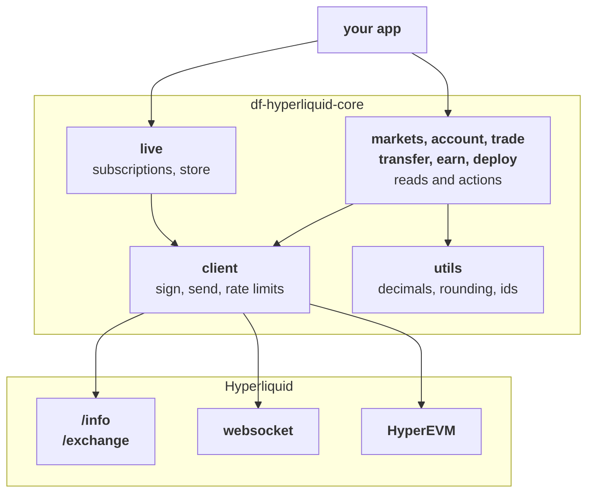

<p align="center">
  <a href="https://dfurrer.com">
    <picture>
      <source media="(prefers-color-scheme: dark)" srcset="https://dfu-cl-storybook.pages.dev/brand/markdfu-raised.svg">
      
    </picture>
  </a>
</p>

# df-hyperliquid-core

Rust SDK for [Hyperliquid](https://hyperliquid.xyz): markets, trading, transfers, earn and deploy in one crate, with exact decimals, signing and native or wasm transports.

## SDK

```text
df-hyperliquid-core
├── client        /info, /exchange, websocket, HyperEVM RPC, rate limits, Client
│   ├── evm       JSON-RPC, transactions, ABI, precompiles, CoreWriter
│   ├── native    reqwest and tokio transport (feature native)
│   └── web       fetch and WebSocket transport (feature web)
├── markets       perps, spot, HIP-3 dexes, outcomes, books, candles, trades, funding
├── account       balances, positions, orders, fills, fees, modes, subaccounts, API wallets
├── trade         orders, cancel, modify, TWAP, TP/SL, leverage, margin, builder fees
├── transfer      sends, withdrawals, Arbitrum deposits, perps and spot, HyperCore to HyperEVM
├── earn          staking, vaults, lending
├── deploy        spot tokens, HIP-3 dexes, HIP-4 outcome markets
├── live          websocket subscriptions, frames, connection state, store
└── utils         decimals, rounding, asset ids, units, time, hex, nonces, signing
```



## Examples

| Example | What it does |
|---|---|
| `cargo run -p df-hyperliquid-core --example perps_page` | Reads BTC's meta, book and context from mainnet, prints the unsigned market order for a $20 long |

## Reference implementations

- [metalliq.xyz](https://metalliq.xyz)
- [tui.hip4.dev](https://tui.hip4.dev)

<br>

<p align="center">
  <sub><sub><a href="https://dfurrer.com">DFU</a></sub></sub>
  &emsp;&emsp;&emsp;
  <sub><a href="https://dfurrer.com">dfurrer.com</a></sub>
  &emsp;&emsp;&emsp;
  <sub><sub><a href="https://dfurrer.com">df.hl</a></sub></sub>
</p>
