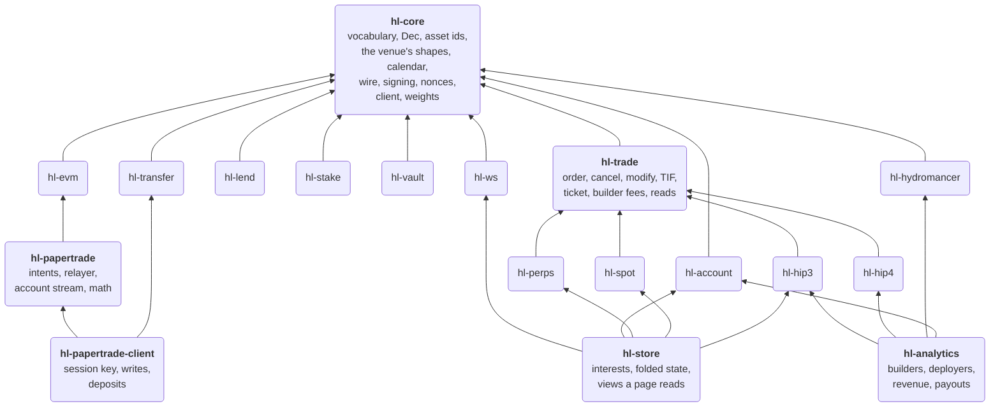

# hl-rust

The Hyperliquid family. `hl-core` is the backbone; every other crate is one product area on top of it.



| Crate | Owns |
|---|---|
| `hl-core` | vocabulary: exact decimals (`Dec`; literals checked when built, checked sums), the side of an order, a fill or a book (`Side`, `B`/`A`), asset ids (perps, spot, HIP-3, HIP-4) and their builder caps, the perp dex (`Dex`) and HIP-3 coins (`dex:SYMBOL`, an id back to its dex and index), builder fees in tenths of a basis point, exact integer units (USDC 1e6, HYPE 1e8), floats kept as written (`Figure`); the venue's shapes, one type each whether `/info` answers them or the socket sends them (`book`; `trade`, a print; `candle` and its `Interval`; `mids`; `context`, perp and spot; `fill`; `order`, with `Tif`, `Tpsl` and `Cloid`; `state`: a dex's clearinghouse, positions and their `Leverage`, spot balances, `activeAssetData`; `ledger`: each row's `Delta`, a type not read kept as written), what is intrinsic to each beside it (a book's touch and mid, a position's side); the calendar (`time`: RFC 3339 instants, civil days, the `YYYYMMDD-HHMM` stamp); each network's endpoints, chains (signature, Arbitrum, HyperEVM) and its USDC and HYPE; system addresses; who may sign what (every action kind, main key or agent, `may_sign`); the deploy auction (`GasAuction`); msgpack wire and JSON in written order; L1 and user-signed signing; nonces; the info and exchange client over a transport trait (`/info` bodies, `/exchange` answers with their `data`) behind the rate-limit gate |
| `hl-account` | clearinghouse and spot state (hl-core's, with how near liquidation a portfolio-margin account stands), account modes and changing them (`userSetAbstraction`, `agentSetAbstraction`; unified back to standard is refused), usable balances (what each kind of market can draw on, read the way the mode says, and which balance pays), worth (counted once, perps not twice) and holdings beside the balances, priced from exact mids (`Prices::of`), onboarding (what is left before an account can trade, from live state), readiness (whether a builder can be paid and what an order naming one needs first), limits (`userRateLimit`: what an address may still send and how fast that runs down), signer rules (hl-core's, re-exported), agent wallets (`approveAgent`, `extraAgents`, `userRole`; no revoke, never re-approve an old agent), builder fee approval (`approveBuilderFee`, `maxBuilderFee`), subaccounts (`createSubAccount`, `subAccountTransfer`, `subAccountSpotTransfer`, `subAccounts`), referrals (`setReferrer`, `referral`, each quote token's figures), `userFees`, `portfolio` |
| `hl-transfer` | usdSend, spotSend, sendAsset (also between the account's own balances), `agentSendAsset` (the same, signed by an agent), usdClassTransfer, withdraw3, amount checks, preTransferCheck, system-address guard, Core to HyperEVM (`spotSend` from a separate account, `sendAsset` from a pooled one; the way back is hl-evm's), plans (the key each needs, the balance a read back checks), ledger history (hl-core's rows) and the row a send made, Arbitrum bridge deposit calldata on both networks |
| `hl-trade` | `order` (limit and trigger, grouping, builder and its cap), `cancel`, `cancelByCloid`, `modify` and `batchModify` (always place for a trigger), `scheduleCancel` (the dead man's switch), `noop`, `twapOrder`, `twapCancel`, `updateLeverage`, `updateIsolatedMargin`; margin tables and the leverage a perp allows (shared by hl-perps and hl-hip3); tick and lot rounding (`Grid`: a price never rounds against the trader, a size toward zero); the ticket (intent to the exact action or a typed refusal: minimum order value, market orders `FrontendMarket` at a slippage bound and never `Gtc`, TP/SL grouped and modified, scales, closing a position); builder fees as a setting (a share of each kind's cap in integer math, no builder named) and the `approveBuilderFee` check; what `/exchange` answers per order, cancel and modify; `openOrders`, `frontendOpenOrders`, `orderStatus`, `historicalOrders`, `userFills`, `userFillsByTime`, `userTwapSliceFills`, `userFees`, `l2Book`, `candleSnapshot`, `recentTrades`, `allMids`, each read into hl-core's shape |
| `hl-perps` | main dex `meta` and `metaAndAssetCtxs`, each perp's asset id, grid and rules, margin tables, leverage checked against what the asset allows and the tier a position reaches, isolated margin; positions and margin summaries (`clearinghouseState`) and `activeAssetData`, hl-core's shapes, `fundingHistory`, `userFunding` (windows and pages), `predictedFundings`, `perpsAtOpenInterestCap`; the account reads take a HIP-3 dex |
| `hl-spot` | `spotMeta` and `spotMetaAndAssetCtxs` (contexts hl-core's), token lookup (index, name, token id, `NAME:0x<tokenId>`, size and wei decimals), pair lookup (index, book name, asset id, tokens) and its grid, a token's USDC price, `tokenDetails`, `spotDeployState`, `spotPairDeployAuctionStatus`; nothing keyed to one network's indexes |
| `hl-hip3` | `perpDexs` and `allPerpMetas` lined up, per-dex `meta` and `metaAndAssetCtxs` (contexts hl-core's), dex asset ids and coins, `perpDexLimits`, `perpDexStatus`, funding multipliers, rates and clamps, margin tables and leverage, `perpDeployAuctionStatus`; no `perpDeploy` until a vector pins it |
| `hl-hip4` | outcome coins (`#`/`+` spellings, asset ids), prices as ticks of 0.00001 and sizes as whole contracts, market orders at the edge of the range or within a slippage, the minimums, whether a mid is a probability, `outcomeMeta` read into markets and questions in words (recurring markets, expiry), `outcomeTemplates` and deployer limits, `l2Book` (hl-core's book, read onto the outcome grid), the complete-set scan (before fees), holdings from the spot side with fills beside them, structural fills kept out of volume, the outcome fee model (closing side only; a deployer's share multiplied out before it is cut, so it rounds once), `settledOutcome`, `userOutcome` split and merge, `outcomeDeploy` (register, settle, sub-deployers; settling cannot be undone) and the checks each step passes first, `activateOutcomeDeployer` |
| `hl-lend` | `borrowLend` (supply, withdraw, borrow, repay; `null` for all), `allBorrowLendReserveStates`, `borrowLendReserveState`, `borrowLendUserState`; utilization, the borrow and supply rates, what a holding backs and what can still be borrowed, health; plans |
| `hl-stake` | `cDeposit`, `cWithdraw`, `tokenDelegate`, validators, delegator summary, delegations, rewards and history, a whole stake with its pending withdrawals; the delegation lock and unstaking queue (a day and seven on mainnet, two and five minutes on testnet, five at once); plans |
| `hl-vault` | `vaultTransfer`, `vaultDetails` (strategies, follower state, what may leave now), `userVaultEquities`, `leadingVaults`; HLP on each network; lockups (HLP four days; others a day on mainnet, twenty seconds on testnet); plans |
| `hl-hydromancer` | Hydromancer, a third-party data provider, mainnet only (`Hydromancer::mainnet`, the caller's key as a bearer header, cut from any error): the L4 book (`l4Book` snapshot decoder, the `l4BookUpdates` socket frames, an `Assembler` that resyncs on a height gap, `Book` with matching and owners, L4 to L2 levels), the outcome builder dashboard, `perpPriceHistoryByTime`, the `builderFills` socket, and Hyperliquid's daily `builder_fills` files (a line that does not read counted, never summed) |
| `hl-ws` | the public websocket, sans-IO: every subscription the docs list (and `assetCtxs`, `spotAssetCtxs`, `userHistoricalOrders`), the subscribe, unsubscribe, ping and post frames, each channel decoded into exact `Dec`, into the hl-core types the `/info` reads give (an unknown one kept as written), and the connection's state machine: resubscribe on open, a ping after 30 s of quiet, a reconnect after 60 s of silence, delays doubling from 250 ms to 20 s with jitter and no last attempt, the venue's per-IP limits refused before anything is sent |
| `hl-evm` | HyperEVM (999 mainnet, 998 testnet) and the Arbitrum side of the bridge: typed JSON-RPC over `Http` (HyperEVM's RPC by network, Arbitrum by URL; `eth_bigBlockGasPrice`, `eth_usingBigBlocks`), exact `U256` quantities, ABI, RLP and EIP-1559 transactions (calls and contract creations; signing is its own `sign` feature), every read precompile `L1Read.sol` names, CoreWriter actions encoded, decoded from `RawAction` logs and read in words, system addresses and the transaction that sends a token back to Core |
| `hl-native` | the wire for native programs, on tokio: hl-core's `Http` through reqwest on rustls (a timeout, nothing retried), the system clock, and `Feed`, one hl-ws session over tokio-tungstenite (subscriptions kept while down and sent on every open, the session's pings, silence and reconnect delay, a post refused while down and an unanswered one reported, never sent again) |
| `hl-web` | the wire for the browser and Workers, on their globals and never `window`: hl-core's `Http` through `fetch`, `Date.now` as the clock, and `Feed`, one hl-ws session over `WebSocket` (subscriptions kept while down and sent on every open, a quiet socket pinged and a silent one dropped on `setTimeout`, dialled again after the session's delay with `Math.random` jitter, a post refused while down and an unanswered one reported, never sent again; typed events read with an async `next`) |
| `hl-store` | the live state an app keeps, sans-IO: interests a page registers and holds by a handle, counted into hl-ws subscriptions (subscribe, and unsubscribe once nothing needs one, into a `Session` of the same network only) within the venue's per-IP limits; socket frames and the crates' `/info` reads, one hl-core type for each piece, folded per market (book, prints, candles, mids, contexts) and per account and dex (clearinghouse, spot, mode, resting orders, fills, fundings, ledger), snapshots told from deltas, a fill held once, each piece stamped with when it was last told and last changed; views: positions, resting orders, what an account can use on a market by its mode (hl-account's), worth counted once, the touch, the mid, a market's context; up to ten accounts, a subaccount at its own address with its own mode |
| `hl-analytics` | who builds and deploys, computed from what the caller read (sans-IO, no clock): the builder board (every builder ranked by outcome volume over 24h, 7d, 30d and all, the fills no builder routed beside them holding no place, shares in hundredths of a percent), the curated builder labels with their provenance, a builder fee as numbers (each kind's cap, a share of it, what it pays on a notional), what a builder code has been paid (`referral`); every HIP-3 dex as its deployer set it up (delegates, live and delisted assets, fee scale range, funding settings) and what its assets are doing, the deployers of more than one dex, and the builders that routed perps on a day from Hyperliquid's day files (ranked, with who was quiet and whose read failed); who lists what on HIP-4 (each venue's markets, questions, open markets, live rows its cap counts, deployer, sub-deployers, first market) and the templates each lists from; a deployer's fees, which no endpoint reports, as an `Estimate` that says its basis: from its own ledger (the USDC no row explains) or from fills by the outcome fee model, split by venue at each market's scale; the revenue projection (traders, growth, volume, the outcome fee model's deployer, builder and referral parts, period by period in integer cents, totals, a year at the last period's rate, a trendline) and the assumptions it is made of; payouts without their files or sends: a payout CSV read and written as text (any of the usual column spellings, refused whole on a bad row or a wallet named twice unless merged), its batch id (SHA-256 over the rows and the paying account, as hip4-tui's payout tool computes it), the append-only JSON-lines ledger and the state it folds to, the guards, the plan (dust, oversized rows, repeats across budgets, slices a balance check each, every blocker) and a reconcile against the treasury's own ledger |
| `hl-papertrade` | Papertrade, a perps venue on HyperEVM priced at Hyperliquid's BBO mid (mainnet only, its contracts checked on chain): every intent a wallet or its session key signs (register a session key, open, close, withdraw to HyperCore, stake, unstake, claim, cancel) as EIP-712 under the venue's three domains, the wallet JSON, the payload the relayer takes and the intent id it answers with, against viem; session keys (30 days, status from the stream, signing in memory behind `sign`) and client-chosen nonces in two lanes; the relayer's calls as pure requests and a client over `Http` (never retried; the relayer refuses other origins, so a page proxies it); the trading state (23-field instrument rows, lifecycle checked), the live account stream (server-sent events split sans-IO, snapshot and patches folded with the app's checks); the protocol summary, markets, queue and recent trades; the venue's integer math as its app computes it (bust price, PnL through the deadband and impact curve and the win fee, open limits and refusals, the PAPER mint rate); deposit address, BBO, win fee and pending rewards read on chain |
| `hl-papertrade-client` | Papertrade for an app, so every frontend trades it as the venue's own app does: the reads over the caller's `Http` (trading state, summary, volumes, queue and its rank, recent trades, the BBO mid on chain, deposit address, pending rewards, win fee, the account stream's URL); the session key's life (32 bytes from the caller's randomness, kept in the caller's `Store` for 30 days in the 48-byte record the frontends already keep, registered once by the `Wallet` and posted once, renewed an hour before its end; `KeyState` from the record and the stream, the indexer given two minutes to list an accepted key); nonces in two lanes from a random start; open (checked first against the trading state read fresh and the account as last streamed), close (twelve ids to an intent), cancel, all signed by the session key; withdraw, stake, unstake and claim, signed by the wallet and recovered against the owner; each posted once and refused unless the relayer keeps it; deposits from Hyperliquid (the address registered with the sweeper and checked against the factory, the 1 USDC that opens a new HyperCore account, `usdClassTransfer` then `spotSend` from perps, `spotSend` from spot, `sendAsset` from a pooled account), each send signed by the wallet and posted to `/exchange` once. The wallet is handed what a confirm shows: the purpose, the typed-data JSON and its digest |
| `hl` | the umbrella: every crate behind a feature (`markets` and `money` by default, the data crates, `store`, `analytics` and a wire by name, `full`, `sign`), and `Client`, one network: every crate's reads through its rate-limit gate and, with `sign`, actions signed for that network alone, each signature checked against the signer before it is posted and sent once |

## Use

Take the whole family through `hl`, or any crate on its own. `markets` and `money` come by default; ask for the rest by name, and for a wire:

```toml
hl = { path = "../hl-rust/packages/hl", features = ["native", "sign", "store", "ws"] }
```

Read through one network's client. Every crate's reads take it, and each passes the rate-limit gate:

```rust
let client = hl::Client::reader(hl::native::Native::new(), hl::Network::Mainnet, hl::native::clock);
let meta = hl::perps::meta_and_asset_ctxs(&client).await?;
let book = hl::trade::market::l2_book(&client, "BTC", hl::trade::Precision::FULL).await?;
```

Build an order from what a person typed, then send it. With `sign`, the client signs for its own network, checks the signature recovers to the signer, and posts once:

```rust
let order = hl::trade::ticket::order(&market, &intent, None)?;
let client = hl::Client::new(hl::native::Native::new(), hl::Network::Testnet, hl::native::clock, key);
let answer = client.send(&order).await?;
```

Keep the websocket open with a `Feed` (`hl::native` or `hl::web`, the same API), and fold what it hands back into an `hl::store::Store` that pages register their interests with. `cargo run -p hl --example perps_page --features native` reads a BTC ticket's market from mainnet and prints the order a $20 market buy would send, without signing anything.

## Rules

- **Layering:** a crate depends on `hl-core`. The four market crates may also depend on `hl-trade`. A composite (`hl-store`, `hl-analytics`, `hl-papertrade`, `hl-papertrade-client`) may depend on any crate below it, never on the umbrella or a wire. Nothing else crosses.
- **Standalone:** no `hl-*` crate depends on an app. hip4-tui, atlas and coreserve are consumers, never dependencies.
- **Targets:** every crate builds native and `wasm32-unknown-unknown`. No tokio, no OS keychain in the family; transports plug in from outside.
- **Money:** `Dec`, never floats (`clippy::float_arithmetic` denied in every crate).
- **Signing:** golden vectors before any new action (`vectors/`, each file naming the implementation that made it). A crate never holds the user's wallet key.
- **Features:** the curve is `hl-core`'s `sign` feature. Every crate takes `hl-core` without it, so an app that only reads never compiles `k256`; one that signs asks for it.
- **Rate limit:** `hl_core::Api` gates Hyperliquid's `/info` and `/exchange`, one network's endpoints behind one gate: reads hold back near the IP's 1,200 a minute, and a 429 closes the gate for everything. Hydromancer and HyperEVM's RPC go through `Http` directly, outside it.
- **Network:** mainnet or testnet, and every signature names one: an action signed for one network is never valid on the other, so nothing assumes it. `/exchange` is never retried.
- **Builder:** none by default. An order carries a builder and its fee only when the caller passes one; no crate names a builder of its own.

## Check

`just check` is the gate before any commit: fmt, clippy native and wasm, every test, and the feature check.
