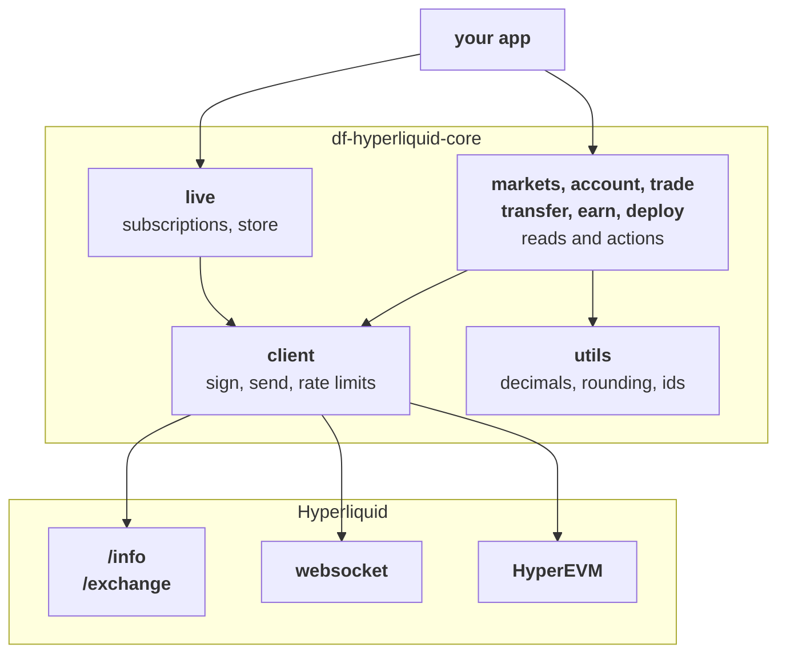

<p align="center">
  <a href="https://dfurrer.com">
    <picture>
      <source media="(prefers-color-scheme: dark)" srcset="https://dfu-cl-storybook.pages.dev/brand/markdfu-raised.svg">
      
    </picture>
  </a>
</p>

# df-hyperliquid-core

[](https://crates.io/crates/df-hyperliquid-core)
[](https://docs.rs/df-hyperliquid-core)
[](#license)
[](https://github.com/dennisfurrer/df-hyperliquid-core/actions/workflows/check.yml)

Rust SDK for [Hyperliquid](https://hyperliquid.xyz): markets, trading, transfers, earn and deploy in one crate, with exact decimals, signing and native or wasm transports.

## SDK

```text
df-hyperliquid-core
├── client          the Client, networks, rate limits
│   ├── http        /info and /exchange, the wire, the limit gate
│   ├── evm         HyperEVM JSON-RPC, transactions, ABI, precompiles, CoreWriter
│   ├── native      reqwest and tokio-tungstenite (feature native)
│   └── web         fetch and WebSocket (feature web)
├── markets         what is listed and what it trades at
│   ├── perps       meta, funding, margin tables
│   ├── spot        meta, token details
│   ├── dexes       HIP-3 dexes and their limits
│   └── outcomes    HIP-4 meta, books, prices, templates
├── account         what an address holds and who may sign for it
│   ├── holdings    perps, spot, outcomes, worth, what an order may use
│   ├── history     fills, orders, ledger, portfolio, fees
│   ├── keys        signers, API wallets, builder approvals
│   └── settings    margin mode, subaccounts, referrals, rate limits
├── trade           orders on every market
│   ├── orders      market, limit, trigger, TP/SL, scale, TWAP, close
│   ├── manage      cancel, modify, dead man's switch
│   ├── margin      leverage, isolated margin, margin tables
│   ├── builder     builder fees and their caps
│   └── outcomes    outcome fees, split and merge
├── transfer        sends, withdrawals, Arbitrum deposits, HyperCore to HyperEVM
├── earn            staking, vaults, lending
├── deploy          spot tokens, deploy auctions, HIP-3 dexes, HIP-4 outcome markets
├── live            websocket subscriptions, frames, connection state, a kept store
└── utils           decimals, rounding, asset ids, units, time, hex, nonces, signing
```



## Examples

| Example | What it does |
|---|---|
| `cargo run -p df-hyperliquid-core --example market_order` | Reads BTC's meta, book and context from mainnet, prints the unsigned market order for a $20 long |
| `HL_PRIVATE_KEY=0x... cargo run -p df-hyperliquid-core --example signed_order` | Signs a post-only BTC limit buy 30% under the mid and the cancel for it, and prints both signed bodies; with `HL_SEND=1` it places the order on mainnet and cancels it |
| `cargo run -p df-hyperliquid-core --example subscribe` | Opens the mainnet websocket, subscribes to BTC's book and trades, prints ten updates and exits |
| `HL_PRIVATE_KEY=0x... cargo run -p df-hyperliquid-core --example outcome_trade` | Lists the HIP-4 outcome markets with their titles, picks one with a bid, signs a post-only buy of Yes at half the bid and the cancel for it; with `HL_SEND=1` it places the order and cancels it |
| `cargo build -p df-hyperliquid-core --example web_book --no-default-features --features sign,web --target wasm32-unknown-unknown` | Builds a wasm module that exports `btcMid()`, which reads BTC's book through the global `fetch`; bind it with `wasm-bindgen --target nodejs` or `--target web` |

## Feature parity

Set against the [Hyperliquid API docs](https://hyperliquid.gitbook.io/hyperliquid-docs/for-developers/api). Supported means every request or action the docs list for that area is in the crate; Partial names what is missing.

| API area | Status | Module | Missing |
|---|---|---|---|
| Info: perps (meta, contexts, all dexes' metas, funding, predicted funding, open interest caps, active asset data, dex limits and status, categories, deploy auction) | Partial | `markets::perps`, `markets::dexes`, `account::holdings`, `deploy` | `perpAnnotation`, `perpConciseAnnotations` |
| Info: spot (meta, contexts, balances, token details, deploy state, pair deploy auction) | Supported | `markets::spot`, `account::holdings`, `deploy` | |
| Info: HIP-4 outcomes (meta, templates, settled outcomes, deployer limits) | Supported | `markets::outcomes` | |
| Info: market data (mids, L2 book, candles, recent trades) | Supported | `markets` | |
| Info: user state (clearinghouse, open orders, order status, rate limit, role, subaccounts, fees, referral, abstraction, agents, builder fee approval) | Partial | `account` | `approvedBuilders`, `userDexAbstraction` (deprecated) |
| Info: history (fills, fills by time, historical orders, TWAP history and slice fills, funding, ledger, portfolio) | Supported | `account::history`, `markets::perps` | |
| Info: vaults, staking and lending (vault details and equities, delegations, staking summary, history and rewards, validators, borrow and lend states) | Supported | `earn` | |
| Exchange: orders (limit, market, trigger, TP/SL, scale, close) | Partial | `trade::orders` | `trailingStop` |
| Exchange: cancel, cancel by cloid, schedule cancel, noop | Supported | `trade::manage` | |
| Exchange: modify, batch modify | Supported | `trade::manage` | |
| Exchange: TWAP order and cancel | Supported | `trade::orders` | |
| Exchange: leverage and isolated margin | Supported | `trade::margin` | |
| Exchange: transfers (`usdSend`, `spotSend`, `sendAsset`, `agentSendAsset`, `usdClassTransfer`, subaccount transfers, HyperCore to HyperEVM) | Partial | `transfer`, `account::settings` | `sendToEvmWithData` |
| Exchange: withdrawals (`withdraw3`) and Arbitrum deposits | Supported | `transfer` | |
| Exchange: vaults (`vaultTransfer`) | Partial | `earn::vaults` | `hip3LiquidatorTransfer` |
| Exchange: staking (`cDeposit`, `cWithdraw`, `tokenDelegate`) | Partial | `earn::staking` | `cDeposit2`, `claimRewards` |
| Exchange: lending (`borrowLend`) | Supported | `earn::lending` | |
| Exchange: API wallets (`approveAgent`) | Supported | `account::keys` | |
| Exchange: builder fees (`approveBuilderFee`) | Supported | `account::keys`, `trade::builder` | |
| Exchange: account settings (`userSetAbstraction`, `agentSetAbstraction`, `createSubAccount`, `setReferrer`) | Partial | `account::settings` | `reserveRequestWeight`; `userDexAbstraction` and `agentEnableDexAbstraction` (deprecated) |
| Exchange: HIP-4 outcome positions (`userOutcome`) | Partial | `trade::outcomes` | `mergeQuestion`, `negateOutcome` (split and merge are in) |
| Exchange: multi-sig (`multiSig`) | Partial | `utils::sign::multi_sig` | `convertToMultiSigUser` |
| Exchange: validator actions (`validatorL1Stream`, `authorizeAqav2Role`) | Not yet | | all |
| Deploy: spot tokens (`spotDeploy`) | Not yet | `deploy` has the reads only | all actions |
| Deploy: HIP-3 perp dexes (`perpDeploy`) | Not yet | `deploy`, `markets::dexes` have the reads only | all actions |
| Deploy: HIP-4 outcome markets (`outcomeDeploy`, `activateOutcomeDeployer`) | Supported | `deploy::outcomes` | |
| Websocket subscriptions | Partial | `live`, `client::native::Feed`, `client::web::Feed` | `l2`, `pac`, `sac` |
| Websocket post (info reads and signed actions) | Supported | `live::Post`, `Feed::post` | |
| HyperEVM JSON-RPC | Partial | `client::evm::rpc` | `net_version`, `web3_clientVersion`, `eth_getBlockByHash`, `eth_getBlockReceipts`, `eth_getBlockTransactionCountByHash`, `eth_getBlockTransactionCountByNumber`, `eth_getTransactionByBlockHashAndIndex`, `eth_getTransactionByBlockNumberAndIndex`, `eth_syncing`, `eth_getSystemTxsByBlockHash`, `eth_getSystemTxsByBlockNumber` |
| HyperCore read precompiles (`0x0800` to `0x0814`) | Supported | `client::evm::precompiles` | |
| CoreWriter (actions 1 to 17) | Supported | `client::evm::corewriter` | |

## Tests

```text
packages/core
├── src/**/tests       unit: decimals, rounding, encoding, signing, refusals, state machines
├── tests
│   ├── conformance    signatures match @nktkas/hyperliquid, the Python SDK and viem
│   ├── mocked         whole journeys through Client against a fake venue that checks every signature
│   └── live           mainnet, read only: every read, websocket channel and HyperEVM read
├── fixtures           recorded venue answers
└── vectors            what other implementations produce
```

| Command | What it runs |
|---|---|
| `just check` | format, lint, unit, conformance, mocked, the browser transport in Node, docs |
| `just live` | the live suite against mainnet, each answer held against its recording |
| `just cover` | line coverage of everything but the live suite |

## Reference implementations

- [metalliq.xyz](https://metalliq.xyz)
- [tui.hip4.dev](https://tui.hip4.dev)

## License

Licensed under either of

- Apache License, Version 2.0 ([LICENSE-APACHE](LICENSE-APACHE))
- MIT license ([LICENSE-MIT](LICENSE-MIT))

at your option.

Unless you explicitly state otherwise, any contribution intentionally submitted for inclusion in this crate, as defined in the Apache-2.0 license, shall be dual licensed as above, without any additional terms or conditions.

<br>

<p align="center">
  <sub><sub><a href="https://dfurrer.com">DFU</a></sub></sub>
  &emsp;&emsp;&emsp;
  <sub><a href="https://dfurrer.com">dfurrer.com</a></sub>
  &emsp;&emsp;&emsp;
  <sub><sub><a href="https://dfurrer.com">df.hl</a></sub></sub>
</p>
